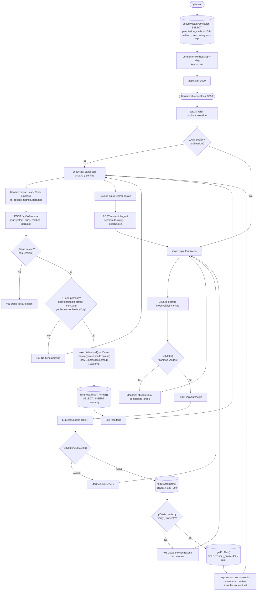
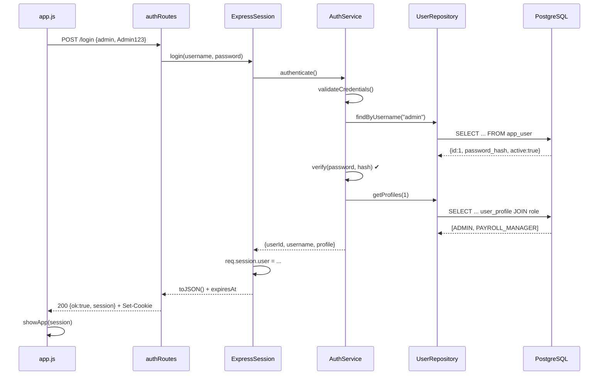
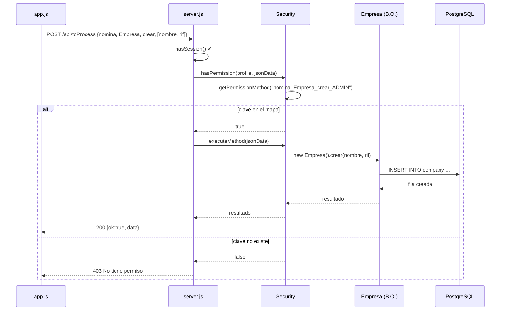
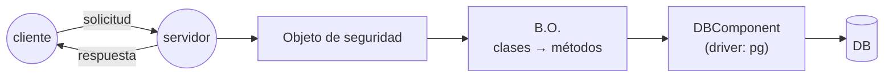

# Login, sesión y seguridad — Explicación del programa

Demo de un sistema de nómina con:
**validación de datos → acceso a la base de datos → datos del usuario en sesión → UI → objeto de seguridad**.

Stack: Node.js + Express 5 + express-session + pg, PostgreSQL 17 en Docker, frontend HTML/JS sin frameworks.

---

## 1. Cómo correrlo

```bash
npm install                    # solo la primera vez
docker compose down -v         # solo si la BD ya existía: la recrea con las tablas nuevas
docker compose up -d --build   # levanta la BD (puerto 5433)
docker compose ps              # esperar a que diga "healthy"
npm start                      # servidor en http://localhost:3000
```

Credenciales de prueba:

| Usuario | Contraseña | Perfiles |
|---|---|---|
| `admin` | `Admin123` | ADMIN, PAYROLL_MANAGER |
| `empleado` | `Empleado123` | EMPLOYEE |

Para cerrar: `Ctrl + C` en el servidor y `docker compose down` (con `-v` se borran los datos y se recrea la BD desde cero).

---

## 2. Estructura y rol de cada archivo

| Capa | Archivo | Función clave | Qué hace |
|---|---|---|---|
| UI | `frontend/index.html` | — | Dos vistas: formulario de login y panel del usuario con la prueba de seguridad |
| UI | `frontend/app.js` | `validate()`, `api()`, `showLogin()`, `showApp()`, `toProcess()` | Valida en el navegador, llama a la API y pinta la vista |
| Servidor | `src/server.js` | `POST /api/toProcess` | Configura Express y la cookie de sesión, carga los permisos, sirve el frontend, monta `/api/auth` y define el endpoint único de procesos |
| Rutas | `src/routes/authRoutes.js` | `POST /login`, `GET /session`, `POST /logout` | Traduce cada petición HTTP de login a una llamada al objeto de sesión |
| Sesión | `src/session/ExpressSession.js` | `hasSession()`, `login()`, `logout()`, `toJSON()` | El **objeto de sesión**: guarda y expone `userId`, `username`, `profile[]` |
| Lógica | `src/services/AuthService.js` | `validateCredentials()`, `authenticate()` | Valida en el servidor y decide si las credenciales son correctas |
| Seguridad | `src/security/PasswordHasher.js` | `verify()` | Compara la contraseña con el hash `scrypt` guardado |
| Seguridad | `src/security/Security.js` | `loadPermission()`, `getPermissionMethod()`, `hasPermission()`, `executeMethod()` | El **objeto de seguridad**: decide si un perfil puede ejecutar un método y lo ejecuta |
| B.O. | `src/bo/nomina/Empresa.js` | `listar()`, `crear()` | Business Object de ejemplo (subsistema `nomina`, clase `Empresa`) |
| Datos | `src/repositories/UserRepository.js` | `findByUsername()`, `getProfiles()` | Las consultas SQL del login |
| Datos | `src/db/Database.js` | `query()` | Pool de conexiones a PostgreSQL (el *driver*) |
| BD | `db/schema.sql` | — | Modelo completo de nómina (empresas, trabajadores, deducciones…) |
| BD | `db/auth_schema.sql` | — | Tablas de login (`app_user`, `role`, `user_profile`) y de seguridad (`subsystem`, `class`, `method`, `permission_method`) con sus permisos |
| BD | `db/seed_dev.sql` | — | Usuarios `admin` y `empleado` con sus perfiles |
| Docker | `docker/Dockerfile`, `docker-compose.yml` | — | Imagen de Postgres que ejecuta los 3 SQL al crearse |

### Modelo de datos

```mermaid
erDiagram
    app_user  ||--o{ user_profile      : "tiene"
    role      ||--o{ user_profile      : "define"
    subsystem ||--o{ class             : "contiene"
    class     ||--o{ method            : "contiene"
    method    ||--o{ permission_method : "se permite en"
    role      ||--o{ permission_method : "tiene"
    app_user {
        bigint id PK
        text username
        text password_hash
        boolean active
    }
    role {
        bigint id PK
        text code
        text name
    }
    user_profile {
        bigint id PK
        bigint user_id FK
        bigint role_id FK
        text display_name
        boolean active
    }
    subsystem {
        bigint id PK
        text code
    }
    class {
        bigint id PK
        bigint subsystem_id FK
        text code
    }
    method {
        bigint id PK
        bigint class_id FK
        text code
    }
    permission_method {
        bigint role_id FK
        bigint method_id FK
    }
```

- Un usuario puede tener **varios perfiles** (por eso `profile` es un arreglo en la sesión).
- Un perfil (rol) tiene permiso sobre **métodos**; cada método pertenece a una **clase** y cada clase a un **subsistema**.

---

## 3. Lógica general

1. **Arranque.**
   - Docker crea la BD y ejecuta los SQL.
   - `npm start` ejecuta `security.loadPermission()`: lee todos los permisos de la BD **una sola vez** y los guarda en memoria.
   - Solo después Express empieza a escuchar en el puerto 3000.
2. **Carga de la página.** `app.js` pregunta `GET /api/auth/session`.
   - Si hay sesión → muestra el panel directamente.
   - Si no → muestra el formulario de login.
3. **Login.** El usuario envía usuario y contraseña:
   1. **Validación en el navegador** (`validate`): campos vacíos o demasiado largos se rechazan sin ir al servidor.
   2. `POST /api/auth/login` → `ExpressSession.login()`.
   3. Si ya había sesión, la devuelve sin volver a autenticar.
   4. Si no, `AuthService.authenticate()`:
      - **Validación en el servidor** (`validateCredentials`) → error **400**.
      - **Acceso a BD**: `findByUsername()` busca el usuario (sin distinguir mayúsculas).
      - `verify()` compara la contraseña con el hash.
      - Usuario inexistente, inactivo o contraseña mala → **401** "Usuario o contraseña incorrectos" (mismo mensaje en los 3 casos, para no revelar qué usuarios existen).
      - Si es correcto, `getProfiles()` trae los perfiles activos.
   5. Se guarda en `req.session.user = { userId, username, profile }`. express-session genera un id aleatorio y lo envía en la cookie firmada `connect.sid` (httpOnly, 8 horas).
   6. La UI recibe la sesión y muestra usuario, ID, perfiles y vencimiento.
4. **Ejecutar un método de negocio** (botones "Listar empresas" / "Crear empresa"):
   1. `toProcess()` envía `POST /api/toProcess` con `{ subsystem, class, method, params }`.
   2. **¿Tiene sesión?** Si no → **401**.
   3. **¿Tiene permiso?** El objeto de seguridad arma la clave `subsistema_clase_método_perfil` para cada perfil del usuario y la busca en el mapa. Si ninguna existe → **403**.
   4. **Ejecuto el método.** `executeMethod()` carga la clase del B.O., la instancia y llama al método con los parámetros → **200** con el resultado.
5. **Recargar la página.** El navegador manda la cookie, el servidor encuentra la sesión en memoria y la UI entra sin pedir credenciales.
6. **Logout.** `POST /api/auth/logout` destruye la sesión en el servidor y borra la cookie. La UI vuelve al login.

---

## 4. Diagrama de flujo



### Secuencia de un login correcto



### Secuencia de `POST /api/toProcess`



---

## 5. Respuestas de la API (datos de prueba)

| Petición | Respuesta |
|---|---|
| `GET /api/auth/session` sin cookie | `{"ok":true,"active":false,"session":null}` |
| `POST /login` con `{"username":"","password":""}` | **400** `{"ok":false,"error":"Usuario y contraseña son obligatorios"}` |
| `POST /login` con `{"username":"admin","password":"x"}` | **401** `{"ok":false,"error":"Usuario o contraseña incorrectos"}` |
| `POST /login` con `{"username":"admin","password":"Admin123"}` | **200** ver abajo |
| `POST /logout` | `{"ok":true}` |
| `POST /api/toProcess` sin sesión | **401** `{"ok":false,"error":"Debe iniciar sesión"}` |
| `POST /api/toProcess` `listar` como `admin` o `empleado` | **200** `{"ok":true,"data":[{"id":1,"nombre":"Empresa Demo C.A.","rif":"J-00000000-0"}]}` |
| `POST /api/toProcess` `crear` como `admin` | **200** `{"ok":true,"data":[{"id":2,"nombre":"Nueva C.A.","rif":"J-11111111-1"}]}` |
| `POST /api/toProcess` `crear` como `empleado` | **403** `{"ok":false,"error":"No tiene permiso para ejecutar este método"}` |
| `POST /api/toProcess` con un método o clase no registrados | **403** (la clave no existe en el mapa) |
| `POST /api/toProcess` `crear` con un RIF repetido | **500** `{"ok":false,"error":"Error al ejecutar el método"}` |

Objeto de sesión devuelto tras un login correcto:

```json
{
  "userId": 1,
  "username": "admin",
  "profile": [
    { "profileId": 1, "role": "ADMIN", "roleName": "Administrador", "displayName": "Administrador Demo" },
    { "profileId": 2, "role": "PAYROLL_MANAGER", "roleName": "Analista de nómina", "displayName": "Analista de Nómina" }
  ],
  "expiresAt": "2026-10-20T05:33:47.167Z"
}
```

---

## 6. Objeto de seguridad: metodología

### 6.1 Arquitectura



- **Cliente → servidor → BD**: el cliente nunca toca la BD; manda una **solicitud** y recibe una **respuesta**.
- **Business Object (B.O.)**: componente que representa una entidad del negocio y encapsula sus datos y reglas. Está formado por **clases** con **métodos** (aquí: subsistema `nomina`, clase `Empresa`, métodos `listar` y `crear`).
- **DBComponent / driver**: la única pieza que habla con la BD. Aquí es `src/db/Database.js` con la librería `pg`.
- **Objeto de seguridad**: se coloca entre el endpoint y el B.O. y decide si el perfil del usuario puede ejecutar el método pedido.

### 6.2 Un solo endpoint

Un endpoint se define por **ruta + método HTTP + acción**. En lugar de crear un endpoint por cada operación, hay **uno solo**, `POST /api/toProcess`, y la acción a ejecutar viaja en el cuerpo:

```json
{ "subsystem": "nomina", "class": "Empresa", "method": "crear", "params": ["Nueva C.A.", "J-11111111-1"] }
```

El endpoint siempre hace los mismos tres pasos:

```js
app.post('/api/toProcess', async (req, res) => {
  // 1. ¿tiene sesión?      → req.userSession.hasSession()
  // 2. ¿tiene permiso?     → security.hasPermission(req.session.user.profile, req.body)
  // 3. ejecuto el método   → security.executeMethod(req.body)
});
```

Para agregar una operación nueva **no se toca el endpoint**: se agrega el método en la clase del B.O., se registra en la tabla `method` y se le da permiso en `permission_method`.

### 6.3 Perfiles y permisos

El **perfil** es el mapeo que asocia a un usuario con los accesos (métodos) que puede usar:

```
user ──< user_profile >── role (perfil) ──< permission_method >── method ── class ── subsystem
```

Permisos cargados en la demo:

| Método | ADMIN | PAYROLL_MANAGER | EMPLOYEE |
|---|---|---|---|
| `nomina / Empresa / listar` | ✔ | ✔ | ✔ |
| `nomina / Empresa / crear` | ✔ | ✘ | ✘ |

### 6.4 Mapa de permisos en caché

Consultar la BD en cada petición sería lento, así que los permisos se llevan a memoria en un `Map` nativo de JavaScript (`permissionMethodMap`):

```
key   = subsystem + "_" + class + "_" + method + "_" + perfil
value = true
```

Contenido del mapa en la demo:

```
nomina_Empresa_listar_ADMIN            → true
nomina_Empresa_crear_ADMIN             → true
nomina_Empresa_listar_PAYROLL_MANAGER  → true
nomina_Empresa_listar_EMPLOYEE         → true
```

Si una clave **no está** en el mapa, no hay permiso. Así, un método inexistente, una clase inventada o una ruta trucada (`..`) se rechazan solos con 403, antes de cargar ningún archivo.

> El perfil en la clave es el código del rol (`ADMIN`) en vez del id numérico, para que sea legible en la demo.

### 6.5 Métodos del objeto de seguridad (`src/security/Security.js`)

| Método | Qué hace |
|---|---|
| `loadPermission()` | Hace un `SELECT` que une `permission_method`, `method`, `class`, `subsystem` y `role`, y llena el mapa. Se llama una vez al arrancar el servidor. |
| `Security.key(subsystem, class, method, perfil)` | Arma la clave con el formato de arriba. |
| `getPermissionMethod(key)` | Devuelve `true` si la clave está en el mapa, `false` si no. |
| `hasPermission(profiles, jsonData)` | Como un usuario puede tener varios perfiles, prueba la clave con cada uno; basta con que uno tenga permiso. |
| `executeMethod(jsonData)` | Carga la clase con `require('bo/<subsystem>/<class>')`, crea la instancia y ejecuta `instancia[method](...params)`. Devuelve el resultado. |

`executeMethod` sigue la idea vista en clase:

```js
executeMethod(jsonData) {
  const Clase = require(jsonData.class);         // carga la clase del B.O.
  const instancia = new Clase();                  // la instancia
  return instancia[jsonData.method](...params);   // ejecuta el método pedido
}
```

El objeto se exporta como **una sola instancia** (`module.exports = new Security()`), así todo el servidor comparte el mismo mapa.

### 6.6 Simplificaciones respecto a la metodología completa

Para mantener la demo simple se dejó fuera:

- **`option` / `permission_option` y `getPermissionOption()`**: permisos sobre opciones de menú o pantallas. Con los permisos de métodos ya se muestra el concepto.
- **`setPermissionMethod()` / `setPermissionOption()`**: los permisos se cambian en la BD y se recargan al reiniciar el servidor.
- **Sentencias SQL en un archivo YAML (`db.exe("getUser", [...])`)**: las consultas están escritas directamente en el código.
- **Número de transacción (`tx`)**: el cliente envía `subsystem`, `class` y `method` directamente.
