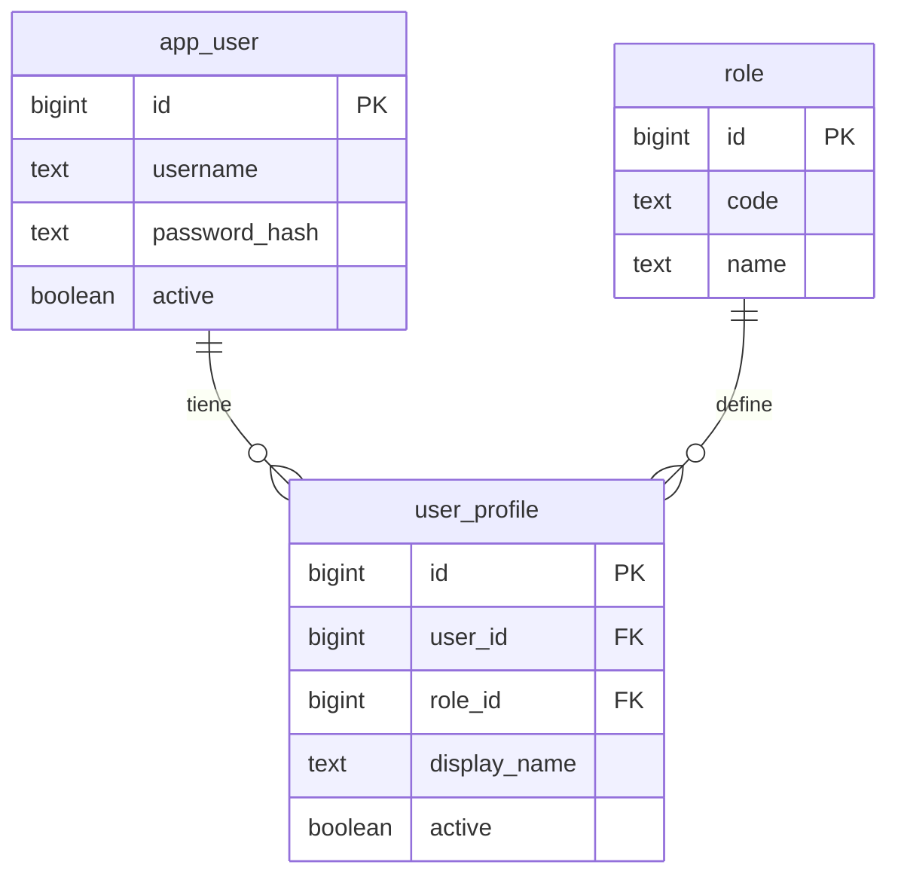
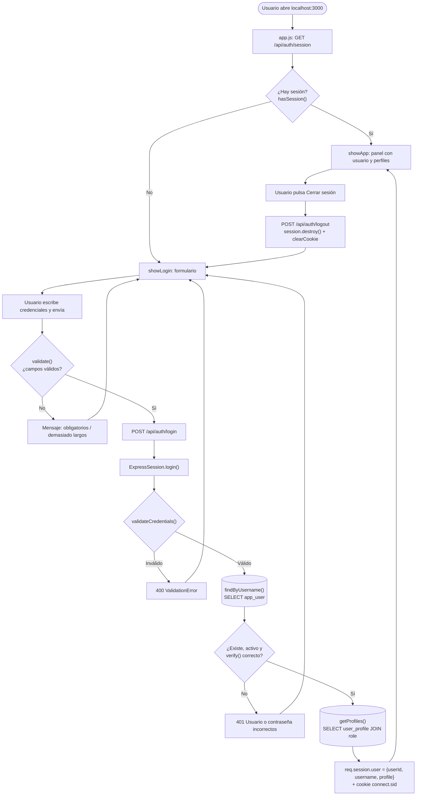
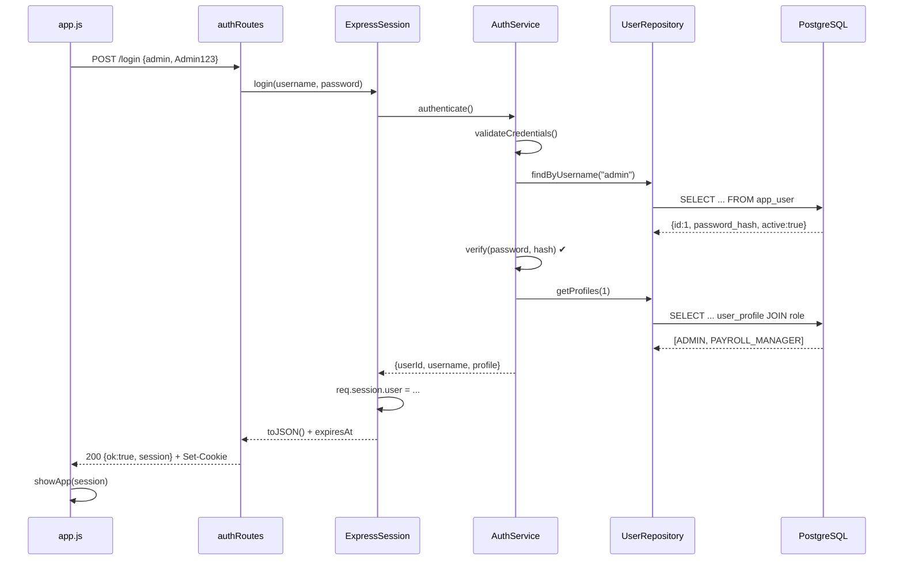

# Login y sesión de usuario — Explicación del programa

Demo de un proceso de inicio de sesión para un sistema de nómina:
**validación de datos → acceso a la base de datos → datos del usuario en sesión → UI**.

Stack: Node.js + Express 5 + express-session + pg, PostgreSQL 17 en Docker, frontend HTML/JS sin frameworks.

---

## 1. Cómo correrlo

```bash
npm install                    # solo la primera vez
docker compose up -d --build   # levanta la BD (puerto 5433)
docker compose ps              # esperar a que diga "healthy"
npm start                      # servidor en http://localhost:3000
```

Credenciales de prueba: **admin / Admin123** (tiene 2 perfiles: ADMIN y PAYROLL_MANAGER).

Para cerrar: `Ctrl + C` en el servidor y `docker compose down` (con `-v` se borran los datos y se recrea la BD desde cero).

---

## 2. Estructura y rol de cada archivo

| Capa | Archivo | Función clave | Qué hace |
|---|---|---|---|
| UI | `frontend/index.html` | — | Dos vistas: formulario de login y panel del usuario |
| UI | `frontend/app.js` | `validate()`, `api()`, `showLogin()`, `showApp()` | Valida en el navegador, llama a la API y pinta la vista |
| Servidor | `src/server.js` | — | Configura Express, la cookie de sesión, sirve el frontend y monta `/api/auth` |
| Rutas | `src/routes/authRoutes.js` | `POST /login`, `GET /session`, `POST /logout` | Traduce cada petición HTTP a una llamada al objeto de sesión y a un código HTTP |
| Sesión | `src/session/ExpressSession.js` | `hasSession()`, `login()`, `logout()`, `toJSON()` | El **objeto de sesión**: guarda y expone `userId`, `username`, `profile[]` |
| Lógica | `src/services/AuthService.js` | `validateCredentials()`, `authenticate()` | Valida en el servidor y decide si las credenciales son correctas |
| Seguridad | `src/security/PasswordHasher.js` | `verify()` | Compara la contraseña con el hash `scrypt` guardado |
| Datos | `src/repositories/UserRepository.js` | `findByUsername()`, `getProfiles()` | Las consultas SQL del login |
| Datos | `src/db/Database.js` | `query()` | Pool de conexiones a PostgreSQL |
| BD | `db/schema.sql` | — | Modelo completo de nómina (empresas, trabajadores, deducciones…) |
| BD | `db/auth_schema.sql` | — | Tablas `app_user`, `role`, `user_profile` |
| BD | `db/seed_dev.sql` | — | Usuario `admin` con sus 2 perfiles |
| Docker | `docker/Dockerfile`, `docker-compose.yml` | — | Imagen de Postgres que ejecuta los 3 SQL al crearse |

### Modelo de datos del login



Un usuario puede tener **varios perfiles** (por eso `profile` es un arreglo en la sesión).

---

## 3. Lógica general

1. **Arranque.** Docker crea la BD y ejecuta los SQL. `npm start` levanta Express en el puerto 3000.
2. **Carga de la página.** `app.js` pregunta `GET /api/auth/session`.
   - Si hay sesión → muestra el panel directamente.
   - Si no → muestra el formulario de login.
3. **Login.** El usuario envía usuario y contraseña:
   1. **Validación en el navegador** (`validate`): campos vacíos o demasiado largos se rechazan sin ir al servidor.
   2. `POST /api/auth/login` → `ExpressSession.login()`.
   3. Si ya había sesión, la devuelve sin volver a autenticar.
   4. Si no, `AuthService.authenticate()`:
      - **Validación en el servidor** (`validateCredentials`) → error **400**.
      - **Acceso a BD**: `findByUsername()` busca el usuario (sin distinguir mayúsculas).
      - `verify()` compara la contraseña con el hash.
      - Usuario inexistente, inactivo o contraseña mala → **401** "Usuario o contraseña incorrectos" (mismo mensaje en los 3 casos, para no revelar qué usuarios existen).
      - Si es correcto, `getProfiles()` trae los perfiles activos.
   5. Se guarda en `req.session.user = { userId, username, profile }`. express-session genera un id aleatorio y lo envía en la cookie firmada `connect.sid` (httpOnly, 8 horas).
   6. La UI recibe la sesión y muestra usuario, ID, perfiles y vencimiento.
4. **Recargar la página.** El navegador manda la cookie, el servidor encuentra la sesión en memoria y la UI entra sin pedir credenciales.
5. **Logout.** `POST /api/auth/logout` destruye la sesión en el servidor y borra la cookie. La UI vuelve al login.

---

## 4. Diagrama de flujo



### Secuencia de un login correcto



---

## 5. Respuestas de la API (datos de prueba)

| Petición | Respuesta |
|---|---|
| `GET /api/auth/session` sin cookie | `{"ok":true,"active":false,"session":null}` |
| `POST /login` con `{"username":"","password":""}` | **400** `{"ok":false,"error":"Usuario y contraseña son obligatorios"}` |
| `POST /login` con `{"username":"admin","password":"x"}` | **401** `{"ok":false,"error":"Usuario o contraseña incorrectos"}` |
| `POST /login` con `{"username":"admin","password":"Admin123"}` | **200** ver abajo |
| `POST /logout` | `{"ok":true}` |

Objeto de sesión devuelto tras un login correcto:

```json
{
  "userId": 1,
  "username": "admin",
  "profile": [
    { "profileId": 1, "role": "ADMIN", "roleName": "Administrador", "displayName": "Administrador Demo" },
    { "profileId": 2, "role": "PAYROLL_MANAGER", "roleName": "Analista de nómina", "displayName": "Analista de Nómina" }
  ],
  "expiresAt": "2026-10-20T05:33:47.167Z"
}
```
