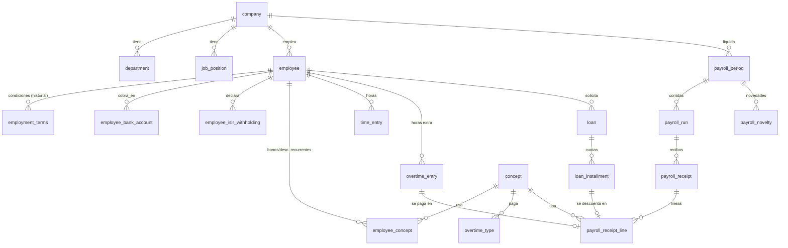

# Modelo de datos – Sistema de Nómina (Venezuela)

Esquema ejecutable: [`db/schema.sql`](../db/schema.sql) (PostgreSQL, schema `payroll`). Solo estructura, sin lógica.

## Diagrama (ER)

## Decisiones de diseño

| Tema | Decisión |
|---|---|
| Fijo vs. por horas | `employment_terms.salary_type` (`FIXED` = monto mensual, `HOURLY` = tarifa/hora). Un trabajador puede cambiar de tipo con historial. |
| Frecuencia de pago | `employment_terms.pay_frequency` (semanal/quincenal/mensual). Cada `payroll_period` es de una sola frecuencia; el trabajador cae en los períodos de su frecuencia. |
| Historial | `employment_terms` con vigencia y constraint `EXCLUDE` (sin solapes). El recibo guarda `terms_id` como snapshot. |
| Leyes cambiantes | Tasas, topes, salario mínimo y U.T. son **datos** (`legal_deduction_rule`, `statutory_parameter`) con vigencia, no constantes en código. |
| Conceptos | Catálogo único `concept` (asignación / deducción / aporte patronal) usado por recurrentes, novedades, horas extra y recibos. |
| Recibos inmutables | `payroll_receipt` + `payroll_receipt_line` guardan base, tasa y monto ya calculados; recalcular = nueva `payroll_run` (`run_number`). |
| Moneda | Cada monto con `currency`; `exchange_rate` por fecha y tasa usada en la corrida. |

## Cobertura de requisitos

**Descuentos de ley** (`legal_deduction_rule`, valores a cargar como datos iniciales; verificar vigencia con asesoría legal/contable):

| Código | Trabajador | Patrono | Tope | Notas |
|---|---|---|---|---|
| IVSS (Seguro Social) | 4% | 9–11% según riesgo | 5 salarios mínimos | Base semanal: salario×12/52 × lunes del período (`mondays_count`) |
| PARO_FORZOSO | 0,5% | 2% | 10 salarios mínimos | Igual base semanal |
| FAOV (BANAVIH) | 1% | 2% | sin tope | Sobre salario integral |
| INCES | 0,5% (sobre utilidades) | 2% (nómina trimestral) | — | `base_kind = PROFIT_SHARING` para el aporte del trabajador |
| ISLR | % individual | — | — | `employee_islr_withholding` (AR-I), no es regla fija |

**Descuentos opcionales** y **bonos fijos**: `employee_concept` (monto fijo o % de base, con vigencia y `applies_to` para limitarlos a ciertas frecuencias). Ej.: caja de ahorros, sindicato, seguro HCM, cestaticket, bono de producción.

**Bonos/descuentos puntuales**: `payroll_novelty` (por período).

**Préstamos**: `loan` + `loan_installment` (tabla de cuotas generada al otorgar). La cuota descontada se enlaza desde `payroll_receipt_line.loan_installment_id` y pasa a `DEDUCTED`.

**Horas extra**: `overtime_type` (recargo 50% LOTTT art. 118; nocturna; descanso/feriado) → `overtime_entry` (aprobada, ligada a la corrida donde se pagó). Horas ordinarias en `time_entry` (base para pago por hora y bono nocturno).
